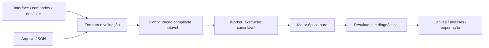

# Arquitetura

## Escolha recomendada

TypeScript de ponta a ponta, React para controles/tabela, Vite para desenvolvimento e empacotamento, Canvas 2D para raios/mapas e SVG opcional para rótulos. Web Worker executa traçado e histogramas. Vitest para matemática e contratos; Playwright para poucos fluxos de integração. Fixar versões e lockfile na implementação, após verificar o ambiente. Não começar com WASM, GPU, Python no servidor ou biblioteca óptica que determine o contrato do domínio.

Motivo: um único modelo de dados entre arquivo, interface e motor; execução offline; raios tridimensionais não exigem renderizador 3D. JavaScript Number fornece precisão dupla. O custo inicial é pequeno frente ao de uma aplicação desktop com múltiplos runtimes. Reavaliar desempenho com medição, não por antecipação.

## Dependências

`optics-core` não conhece React, DOM, armazenamento, workers ou arquivos. Define seus próprios tipos numéricos. `project-format` importa esses tipos e converte documento validado em configuração numérica. `apps/web` depende dos dois. O motor não importa o formato serializado.

## Módulos do motor

- `math`: vetores, matrizes 2×2, tolerâncias e soluções estáveis.
- `geometry`: planos, calotas esféricas, normais, aberturas, validade física.
- `materials`: avaliação de índices a partir de parâmetros já resolvidos.
- `trace`: propagação sequencial, refração, Fresnel, eventos e término.
- `sources`: fontes, amostragem determinística e pesos.
- `paraxial`: matrizes, conjugados, magnificação e estado afocal.
- `analysis`: footprint, histograma, centroides, RMS, energia encerrada e balanço.

APIs conceituais: `validateProject(document)`, `compileProject(document)`, `traceRay(system, ray)`, `traceBatch(system, source, sampling)`, `analyzeTrace(batch, analysisRequest)`, `solveConjugate(systemSegment, objectPlane)`.

Retornar resultados discriminados, nunca um número NaN significando vários erros. Diagnóstico inclui código estável, severidade, ID da superfície e caminho do campo editável. Ex.: `INVALID_APERTURE`, `SURFACE_OVERLAP`, `NO_REAL_IMAGE`, `LOW_EFFECTIVE_SAMPLES`.

## Modelo único de geometria

O documento guarda a sequência e as distâncias; as coordenadas absolutas das superfícies são derivadas. Somente a primeira posição axial é armazenada. O agrupamento visual de duas faces numa lente guarda IDs e não duplica raio, vidro ou espessura.

Para espelhos e inclinação, compilar referenciais locais conforme docs/08 desde o início; a etapa reta usa transformações identidade. O meio anterior de uma interface vem da linha anterior ou do meio inicial. Meio posterior pertence à interface; máscara e tela não mudam o meio. Não permitir espessura negativa para simular um espelho. Componentes compostos/cimentados usam uma interface compartilhada, sem planos coincidentes duplicados.

## Dados e trabalho em background

1. Digitação mantém estado temporário textual: “-” ainda não é uma geometria inválida persistida.
2. Confirmar edição gera documento válido ou diagnóstico, revision incremental e histórico de undo.
3. Worker recebe snapshot imutável, revision, engineVersion, samplingVersion e seed.
4. Prévia barata após debounce; análise refinada explicitamente ou após pausa.
5. Ao chegar resultado, aceitar apenas se revision/configuração ainda coincidirem.
6. Cancelar execução anterior entre blocos; mensagem de cancelamento não interrompe loop síncrono longo. Ceder ao event loop por lote ou reiniciar worker quando necessário.

Não reenviar um objeto por raio. Usar buffers tipados em lotes, Float64 para cálculo; Float32 apenas para coordenadas de desenho se testado. Guardar trajetórias completas de uma amostra pequena e acumuladores para o restante. Evitar matriz N raios × S superfícies × eventos na memória por padrão.

Footprint por superfície pode exigir uma nova execução com captura seletiva. Uma mudança apenas de viewport não dispara simulação. A UI mostra um modo de precisão explícito: superfícies reais ou exploração com lentes finas. O segundo não deve produzir diagnósticos de aberração real de lentes. Primeira versão pode recalcular tudo após mudança óptica; cache incremental só depois de medir.

## Persistência

Importar/exportar arquivo JSON é o contrato principal. Autosave local é conveniência recuperável, separado do arquivo do usuário. Exportar somente documento e opcionalmente metadados de execução; arrays grandes de raios não pertencem ao projeto. CSV de resultados deve trazer unidades, denominadores, seed, versão e revisão.

Importação valida tamanho, versão, tipos, números finitos, limites de contagens e geometria antes de alocar buffers. Fórmulas livres/JavaScript não são executados. “Fórmulas integradas” são funções explícitas e botões de cálculo, não `eval` de strings.

Lente fina é um elemento óptico ideal separado, sem material fictício ou superfícies inventadas. Seu contrato e domínio reduzido estão em docs/09; o núcleo real continua sendo o padrão para representar lentes físicas.

## Estratégia de evolução

Versão do documento independente da versão do motor. Migrações puras e testadas; arquivo de versão futura não abre silenciosamente descartando campos. Preservar uma cópia antes de migrar. Dados ópticos dos materiais ficam embutidos no projeto com origem, evitando que atualização do aplicativo altere um projeto antigo.

Dois modelos de fonte obrigatórios: colimada e ponto. Retângulo é extensão opcional da união discriminada. Uma fonte futura não deve exigir alterar o traçador: ele recebe raios com posição, direção unitária e peso.
